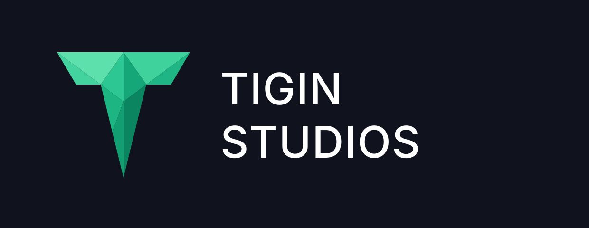
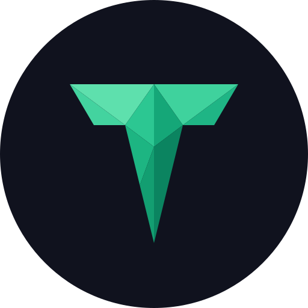

<picture>
  <source media="(prefers-color-scheme: dark)" srcset="assets/logo-horizontal-dark.png">
  <source media="(prefers-color-scheme: light)" srcset="assets/logo-horizontal-light.png">
  
</picture>

### Everything behind a game server.

Websites, plugins and infrastructure for **Minecraft**, **FiveM** and **MTA** servers. 
Built by one team, tested every day on our own server.

 

 

## What we build

<table>
  <tr>
    <td width="33%" valign="top">
      <h3>🌐 Websites</h3>
      Sites designed for game servers: landing, store, voting and support pages.
    </td>
    <td width="33%" valign="top">
      <h3>🧩 Plugins & Scripts</h3>
      Minecraft plugins plus FiveM and MTA scripts: game modes, systems and admin tools.
    </td>
    <td width="33%" valign="top">
      <h3>🛠️ Infrastructure</h3>
      The infrastructure servers run on: setup, network layout and keeping things online.
    </td>
  </tr>
</table>

## Erila Network

The Minecraft Bedrock server we opened in 2024. Everything we build gets tested here first, with real players.

**Join:** `oyna.erilanetwork.com` &nbsp;·&nbsp; [erilanetwork.com](https://erilanetwork.com)

 

## Platforms

## Work with us

Need a website, plugins, scripts or infrastructure for your server? Email us directly, also for partnerships, press or joining the team.

📫 **[contact@tiginstudios.com](mailto:contact@tiginstudios.com)**

 

  © Tigin Studios. All rights reserved.

